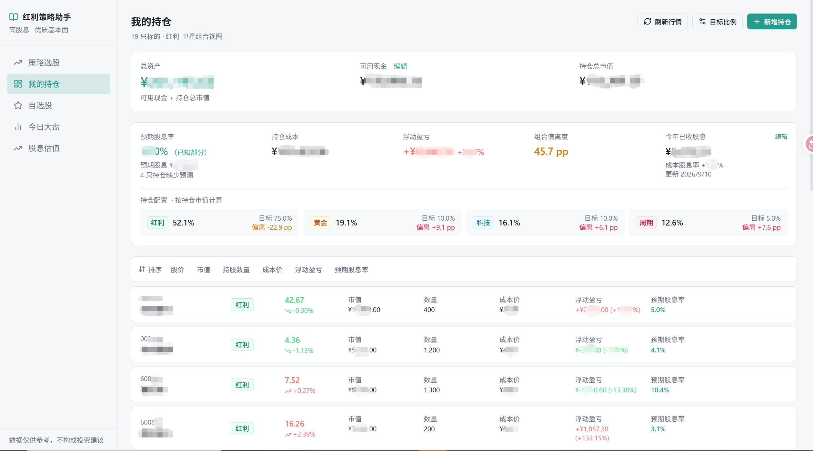
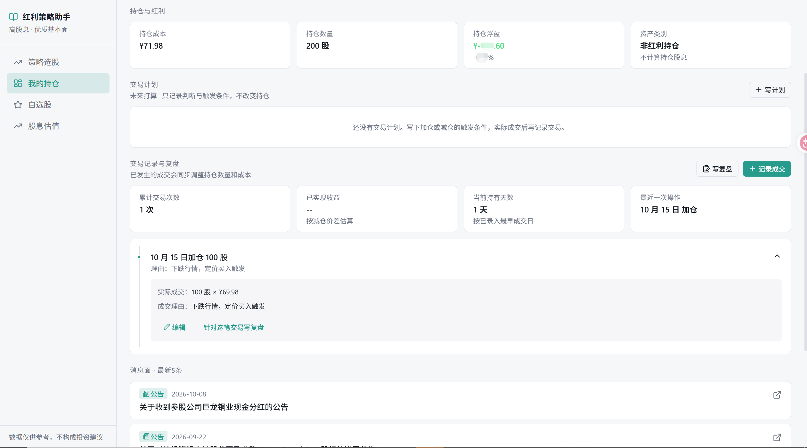
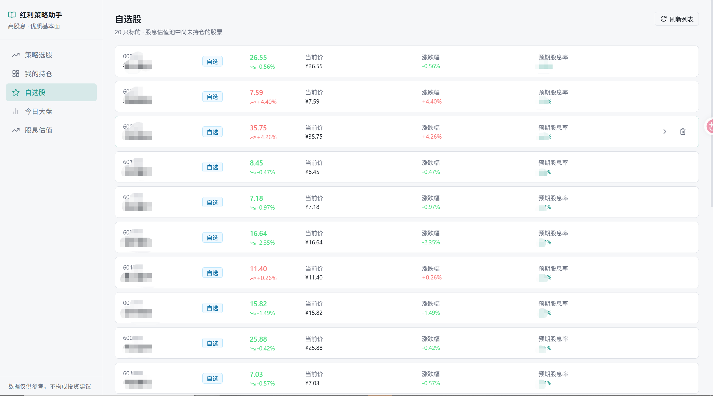
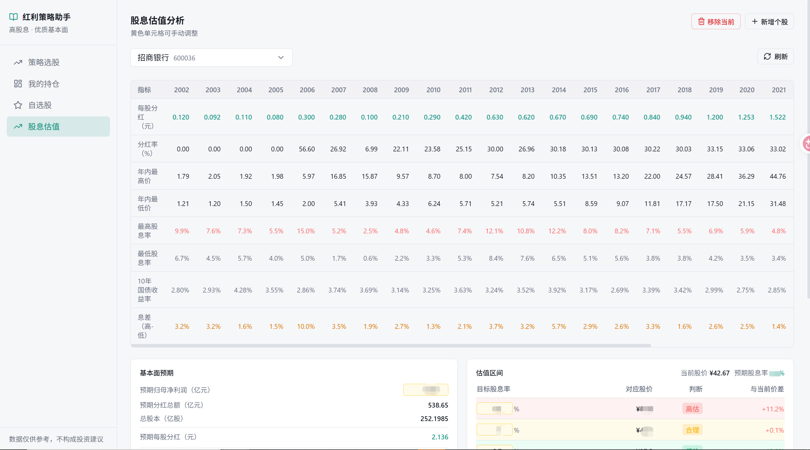

# 红利策略助手

一款在本地运行的红利投资工具，用来管理持仓、估算股息、记录交易决策，并持续复盘自己的投资过程。

## 功能

### 我的持仓：看清组合的红利水平

- 自行新增、编辑持仓，调整各类资产的目标持仓比例，并记录当前可用现金。
- 登记今年已经收到的现金股息，查看持仓市值、成本、浮动盈亏和资产配置偏离度。
- 根据现有持仓的预期股息率，估算未来一年可获得的股息及组合预期股息率，辅助判断整体红利投资水平。缺少预测数据的持仓会单独提示；估算值不代表实际派息。

### 个股详情：记录交易与复盘

个股详情页可查看近期公告、持仓信息和交易时间线。已发生的加仓、减仓记录会同步调整持仓数量与成本；投资计划记录未来的判断和触发条件，不改变当前持仓。还可以针对单笔交易或一段持有周期写复盘，回顾判断、执行和结果。

### 自选股：跟踪尚未持有的标的

自选股来自“股息估值”中已添加、但尚未持有的股票，默认按预期股息率从高到低排列，方便比较和后续判断。

### 股息估值：从预期分红推算价格区间

在“股息估值”中，可以手动输入预期归母净利润、分红率，并结合总股本估算预期每股分红，再按当前股价计算预期股息率。也可以设定目标股息率，查看对应股价及与当前股价的差距，作为判断估值高低的参考。手动假设会影响结果，请结合实际财报自行核对。

以上截图已打码，来自开发过程；实际界面以当前版本为准。

## 安装与数据接口

1. 安装 Node.js 22 或更新版本，运行 `npm ci`。
2. 将 `.env.example` 复制为 `.env`。如需刷新行情和个股相关数据，在 `.env` 中填写自己的 `TUSHARE_TOKEN`。
3. 运行 `npm run dev`，打开终端给出的本地地址。

Tushare Token 可通过 [Tushare 官网](https://tushare.pro/) 获取。[官方权限说明](https://tushare.pro/document/2?doc_id=290)目前将 2000 积分档列为 **200 元/年**；本项目当前功能使用这一档即可。价格与权限如有调整，以官网实时说明为准。未配置 Token 时，本地持仓、交易计划和复盘记录仍可使用，但行情等外部数据无法正常刷新。

首次使用时请录入自己的持仓。项目不附带个人持仓或生成的行情 CSV；如需导入自己的年度股息 CSV，可放在 `data/stock_dividend.csv`，格式可参考测试中的临时样例。

## 数据与隐私

持仓、可用现金、股息记录、交易计划和复盘默认保存在本机 `data/local.db`。可用 `LOCAL_DB_PATH` 指定其他本地路径。数据库、`.env` 和生成的 CSV 均被 Git 忽略，不会随本项目的代码仓库上传。请勿自行将数据库、未打码的持仓截图或含密钥的文件提交到公开仓库；本机备份与设备安全仍需自行管理。

## 后续计划与交流

我会持续优化这个产品，接下来计划完善策略选股、技术分析等部分，也在思考如何加入 AI 功能。如果你想交流红利或高股息投资，欢迎扫码联系我。

## 验证与许可

运行 `node --test tests/*.test.mjs` 和 `npm run build`。测试使用临时数据库与虚构样例，不读取本机持仓。项目采用 [MIT 许可证](LICENSE)。
